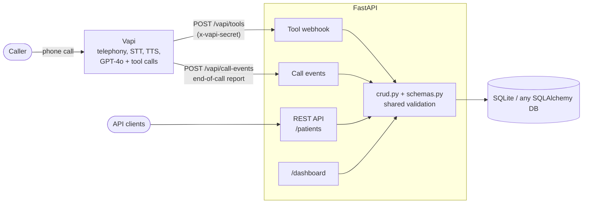

# Voice Patient Registration Agent

[](https://github.com/Muddasirr/voice-patient-intake/actions/workflows/ci.yml)
[](LICENSE)

A phone agent for clinics: it answers a real phone number, registers new patients by voice (or recognizes a returning caller and updates their record), and saves everything through a validated REST API.

## Demo

- **API docs (Swagger):** https://api-production-93604891.up.railway.app/docs
- **Dashboard:** https://api-production-93604891.up.railway.app/dashboard
- **Health:** https://api-production-93604891.up.railway.app/health

<!--  -->

## Why I built it

I built this as a time-boxed engineering challenge: a voice front desk that collects patient intake details over the phone. The hard part isn't speech; it's making an LLM-driven conversation write **correct** data. The agent can mishear, the caller can change their mind, and the call can drop halfway. So the backend treats the voice agent as an untrusted client: every write goes through the same server-side validation as the public API.

## Features

- **Natural intake over the phone.** The agent asks one or two fields at a time instead of reading a form, and handles mid-call corrections ("actually it's spelled…") and full restarts.
- **Duplicate detection.** As soon as it has a phone number, it looks the caller up and offers to update the existing record instead of creating a new one.
- **Confirmation before saving.** The agent reads back the full record and needs a yes before any create or update fires, so nothing half-written lands in the database.
- **Server-side validation.** Names, date of birth, phone, US state and ZIP are validated in Pydantic. Invalid values come back as field-specific errors that the agent turns into a natural re-ask.
- **Appointments, transcripts and a dashboard.** It offers to book a first appointment from mock slots, stores the end-of-call transcript and summary, and serves an HTML dashboard of all patients.
- **Spanish support.** The agent switches language when the caller does, with a multilingual Deepgram transcriber so the speech-to-text keeps up.

## Architecture



| Layer | Choice | Why |
|---|---|---|
| Voice and LLM | [Vapi](https://vapi.ai) with GPT-4o | Handles the phone number, speech-to-text, text-to-speech, interruptions and tool calling, so the time went into conversation design and data correctness instead of a media pipeline. |
| Backend | FastAPI, SQLAlchemy, Pydantic | One service layer (`app/crud.py`, `app/schemas.py`) used by both the voice webhook and the REST API. |
| Database | SQLite | Zero setup. Moving to Postgres is a `DATABASE_URL` change. |
| Hosting | Railway (`Procfile`, `railway.toml`) | Always-on HTTPS endpoint for the Vapi webhooks. |

The prompt and tool schemas live in [`vapi/assistant.json`](vapi/assistant.json), which you can import into the Vapi dashboard.

### API

All responses use the envelope `{ "data": ..., "error": ... }`.

| Method | Endpoint | Description |
|---|---|---|
| GET | `/patients` | List patients. Optional filters: `last_name`, `date_of_birth`, `phone_number`. Excludes soft-deleted records. |
| GET | `/patients/{id}` | One patient. 404 if missing or deleted. |
| POST | `/patients` | Create. 201 on success, 422 on validation error. |
| PUT | `/patients/{id}` | Partial update. |
| DELETE | `/patients/{id}` | Soft delete (sets `deleted_at`). |
| GET | `/patients/{id}/appointments` | The patient's booked appointments. |
| GET | `/patients/{id}/calls` | Stored call transcripts and summaries. |
| GET | `/dashboard` | Server-rendered list of all patients. |
| POST | `/vapi/tools`, `/vapi/call-events` | Vapi webhooks, protected by the `x-vapi-secret` header. |

## Getting started

**Prerequisites:** Python 3.12 (CI also tests 3.11).

```bash
python3 -m venv .venv
source .venv/bin/activate
pip install -r requirements-dev.txt     # app dependencies + pytest + httpx
cp .env.example .env                    # set VAPI_WEBHOOK_SECRET

uvicorn app.main:app --reload --port 8000
```

- Swagger UI: http://localhost:8000/docs
- Dashboard: http://localhost:8000/dashboard
- Two seed patients (Jane Doe, Carlos Martinez) are inserted on first boot if the table is empty.

**Run the tests** (29 tests: CRUD, validation errors, soft delete, Vapi tool calls, appointments, call events, dashboard):

```bash
pytest app/tests -v
```

**Connect a phone number:** deploy the API somewhere public (Railway, or `ngrok http 8000` for a quick test), create a Vapi assistant from `vapi/assistant.json`, replace every `REPLACE_WITH_VAPI_WEBHOOK_SECRET` with your `VAPI_WEBHOOK_SECRET`, point the tool URLs at your host, and assign a Vapi phone number to the assistant.

| Variable | Required | Description |
|---|---|---|
| `VAPI_WEBHOOK_SECRET` | Recommended | Checked against the `x-vapi-secret` header on the webhooks. |
| `DATABASE_URL` | No | SQLAlchemy URL. Defaults to a local SQLite file, `patients.db`. |
| `PORT` | No | Port for uvicorn (default 8000). |

## Challenges and what I learned

- **One validation path for humans and the LLM.** The tool webhook calls `crud.py` directly instead of calling `/patients` over HTTP. This avoids a pointless network hop inside one process and guarantees the agent can't bypass a rule the REST API enforces.
- **Turning validation errors into conversation.** A 422 is useless on a phone call. Tool handlers return `{"success": false, "error": "..."}`, and the prompt tells the model to re-ask only the broken field, not restart the intake.
- **Dropped calls must not leave partial records.** Nothing is written until the caller confirms the full read-back, so a hang-up mid-intake leaves the database untouched. The trade-off is that a long call that drops just before confirmation loses everything collected so far.
- **Conversation quality was mostly prompt design.** The single biggest improvement was asking for one or two fields at a time instead of reading the form aloud.

## Limitations and roadmap

- SQLite lives on the container filesystem, so a redeploy can wipe it. Next step: attach a Railway volume or point `DATABASE_URL` at Postgres.
- `/patients` has no authentication beyond the webhook secret. A real deployment needs API keys or OAuth in front of it.
- Appointment slots are generated mock data, not a real calendar.
- Transcripts attach to a patient only when Vapi's call metadata carries a `patient_id`; otherwise they're stored unattached.
- Agent behavior depends on GPT-4o at call time. The next investment would be an evaluation harness that scores recorded transcripts automatically.

## License

[MIT](LICENSE)
